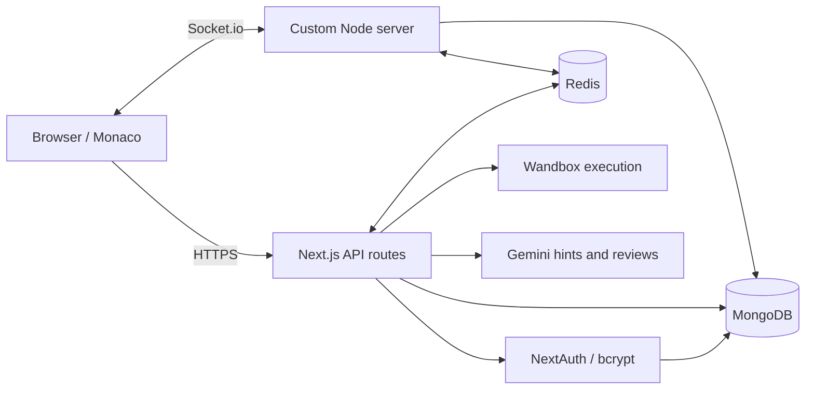
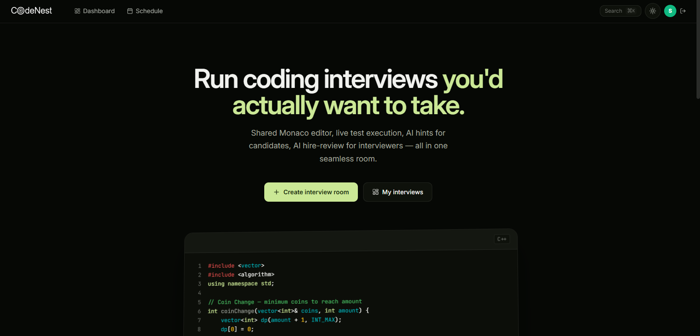
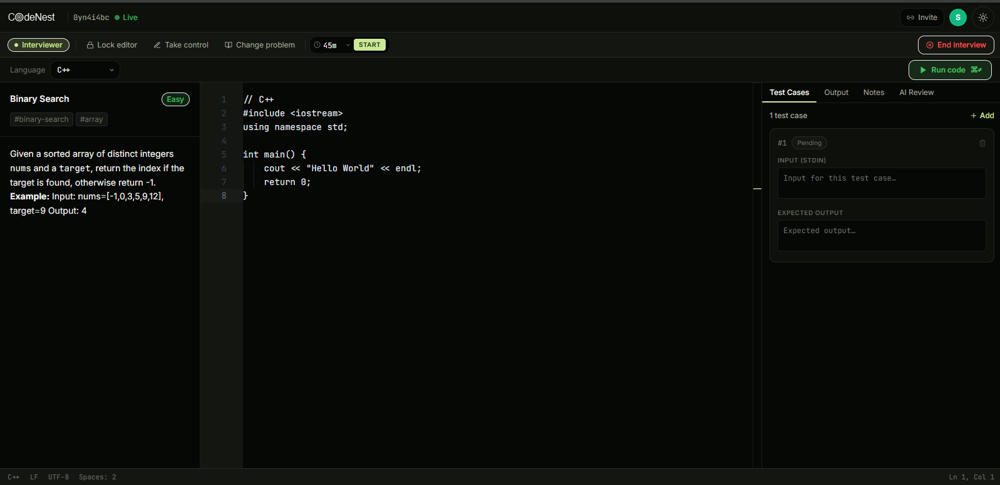

# CodeNest

[](https://github.com/ShlokMaharwal/CodeNest/actions/workflows/ci.yml)


A two-person coding interview platform: an interviewer controls the session, a candidate writes code, and both share a persistent real-time room. Built with Next.js 15, Socket.io, MongoDB, Redis, NextAuth, Monaco, Wandbox, and Gemini.

## Features

- Server-enforced room membership and interviewer controls for locks, timer, problem selection, and interview completion.
- Code, timer, problem, and lock recovery after reconnect, with persisted snapshots and the existing session replay.
- Server-counted candidate hints and configurable AI reviews with validated JSON, saved to the room and returned as compatible Markdown.
- Backend test-case grading with hidden-case privacy: 58 seeded cases across 35 of the 49 catalog problems.
- Optional integrity reports through Socket.io or the room API, stamped with the authenticated actor and server time.
- 113 passing unit, API, and socket integration tests; GitHub Actions verification; a non-root Docker app with MongoDB and Redis.

## Architecture



Next.js and Socket.io run in the same custom Node process. Redis holds live room state, hint counters, invite bindings, and rate-limit windows. MongoDB stores accounts, problems, room records, reviews, integrity events, and replay snapshots.

## Local setup

Use Node.js 22.12 or newer within the Node 22 release line, npm, and Docker Compose (or reachable MongoDB and Redis services).

```bash
git clone https://github.com/ShlokMaharwal/CodeNest.git
cd CodeNest
npm ci --include=dev
cp .env.example .env
```

Set distinct random values for NEXTAUTH_SECRET and INVITE_TOKEN_SECRET, at least 32 characters each. Generate each with `node -e "console.log(require('crypto').randomBytes(32).toString('hex'))"`. Set database URLs and both app URLs for your environment. GEMINI_API_KEY is optional; AI endpoints return a compatible unavailable error when it is absent. GEMINI_MODEL defaults to gemini-2.5-flash. All supported environment settings are listed in [.env.example](./.env.example).

```bash
docker compose up -d mongo redis
npm run seed
npm run dev
```

Open http://localhost:3000. The seed script upserts by title, preserving existing problem IDs instead of clearing the collection. It supplies 49 problems, with grading cases for 35. It does not create user accounts.

## Verify and measure

```bash
npm run typecheck
npm run lint
npm test
npm run test:coverage
npm run build
```

Typecheck generates Next.js route types first. The production build uses tsconfig.build.json so test-only packages are not needed by a production-only install; CI runs lint and the full test typecheck separately. Tests mock MongoDB, Redis, and external providers, while socket integration tests use actual local Socket.io connections.

Coverage artifacts are uploaded by CI. The checked-in badge records 79.82% backend line coverage; see [measured results and methodology](./docs/RESUME.md). To retry the live execution measurement, run `npx tsx scripts/benchmark-execution.ts`. This sends only the fixed sample program to Wandbox and saves results under the ignored coverage directory.

## Deployment

### Render

Connect this repository as a Node web service. Use `npm ci --include=dev && npm run build` as the build command, `npm start` as the start command, and `/api/health` as the health path. The [Render blueprint](./render.yaml) records this configuration. Existing manually configured services must have their dashboard commands updated separately.

The existing Render installation omits development dependencies before building. TypeScript (required for Next.js to read path aliases), type declarations, Tailwind, PostCSS, and Autoprefixer therefore remain in dependencies for compatibility with that installation. The custom Socket.io server runs in both development and production.

Set production MongoDB and Redis URLs, distinct auth/invite secrets, NEXTAUTH_URL, and NEXT_PUBLIC_APP_URL. Use the actual public HTTPS origin for the URLs. SOCKET_ALLOWED_ORIGINS optionally supplies comma-separated exact origins; it otherwise follows NEXTAUTH_URL. Set GEMINI_API_KEY only when AI access is desired.

### Docker Compose

After filling .env with your own secrets:

```bash
docker compose up --build -d
npm run seed
```

Compose runs app, MongoDB, and Redis with health checks and persistent data volumes. The app image runs as a non-root user. MongoDB and Redis host ports bind only to localhost; the app uses their internal container addresses. The host-side seed command uses the localhost database settings in .env. For a public deployment, set matching public app URLs before building. The health endpoint checks MongoDB ping, Redis ping, and process uptime, returning HTTP 503 when a dependency is unavailable.

## Security and data behavior

- Socket roles come from authenticated ownership and verified invite claims. Every room event checks membership in that room; candidate payload roles have no authority.
- Invites expire after 24 hours, bind to one room and candidate identity, and support reconnect by that identity. Redis records consumption and revocation; ending or deleting a room revokes its current invite. The interviewer invite endpoint refreshes expired invites.
- Redis limits logins, execution, AI, room requests, and socket code updates. Source is capped at 100 KB, stdin at 16 KB, and execution at a shared 20-second deadline with bounded retries. JSON requests are capped at 256 KB and grading at 20 cases.
- Zod validates API and socket inputs. Headers restrict framing, content sniffing, and unnecessary browser permissions; Socket.io uses an exact origin allowlist.
- Candidate code, descriptions, and test output are bounded and delimited as untrusted AI data. Review structure and recommendation are validated; AI reviews remain advisory.
- Finished room documents and cached room state expire after 90 days. Integrity events are optional client reports, not independent proof of behavior; no additional UI tracking was added.

## API

| Path                       | Methods            | Purpose                                                           |
| -------------------------- | ------------------ | ----------------------------------------------------------------- |
| /api/auth/[...nextauth]    | GET, POST          | NextAuth session protocol and login                               |
| /api/auth/register         | POST               | Register an account                                               |
| /api/rooms                 | GET, POST          | Creator room list and room creation                               |
| /api/rooms/[roomId]        | GET, PATCH, DELETE | Authorized details, settings, optional integrity reports, cleanup |
| /api/rooms/[roomId]/invite | GET                | Creator invite retrieval and expiry refresh                       |
| /api/problems              | GET                | Paginated, validated problem search                               |
| /api/problems/[id]         | GET                | Public cases and starter code                                     |
| /api/problems/[id]/grade   | POST               | Server-side grading with hidden-case redaction                    |
| /api/execute               | POST               | Existing execution result envelope                                |
| /api/ai/hint               | POST               | Assigned candidate hints with server quota                        |
| /api/ai/review             | POST               | Interviewer review generation and persistence                     |
| /api/health                | GET                | Dependency health and uptime                                      |

Grading accepts `{ "code": "...", "language": "javascript" }`. Supply a complete program that reads each case from stdin and prints its result; output comparison trims outer whitespace. Hidden results expose only index, hidden status, and pass/fail. Optional integrity input is `{ "integrityEvents": [{ "type": "tab-switch" }] }` on the room PATCH API, or `integrity-event` with `{ roomId, event: { type: "large-paste", size: 500 } }`. Caller-provided actor and timestamps are discarded.

## Screenshots




TODO: Capture a current dashboard screenshot after verifying the deployment.

TODO: Capture a current replay screenshot; retain the existing UI.

## License

[MIT](./LICENSE)
