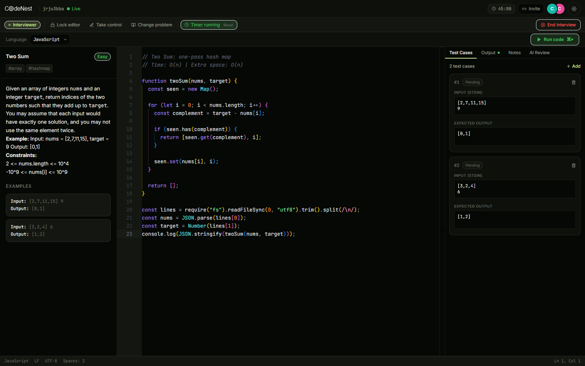
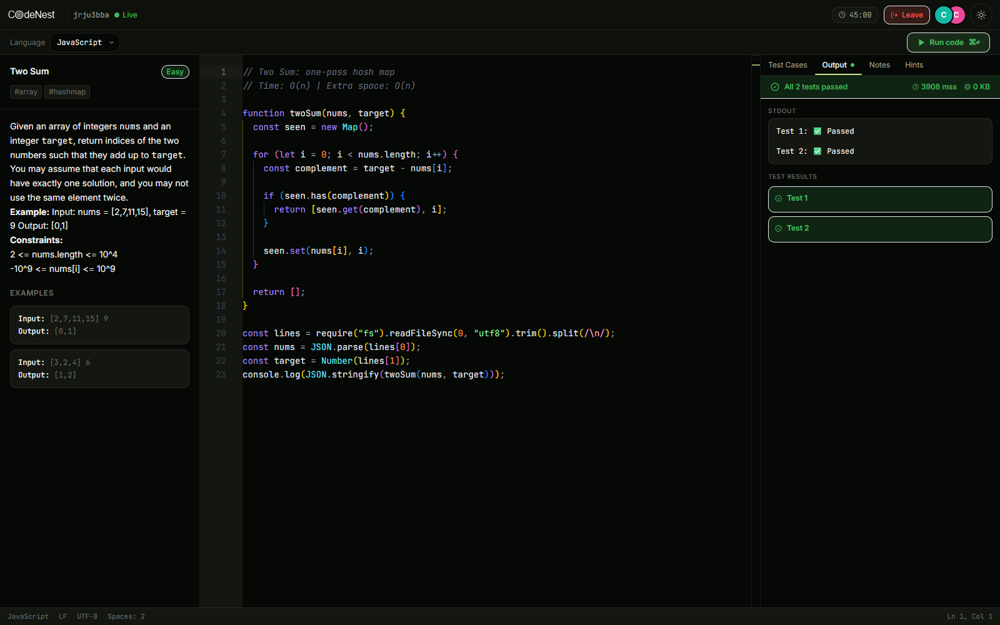
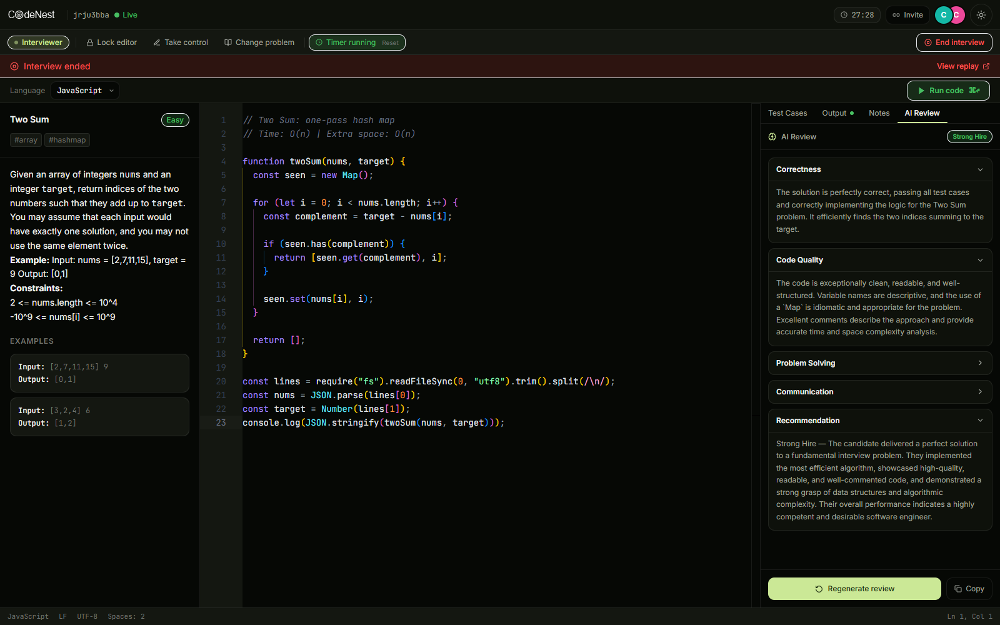
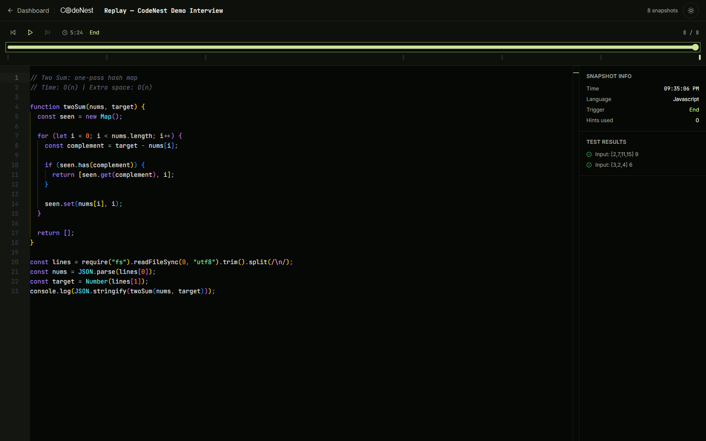
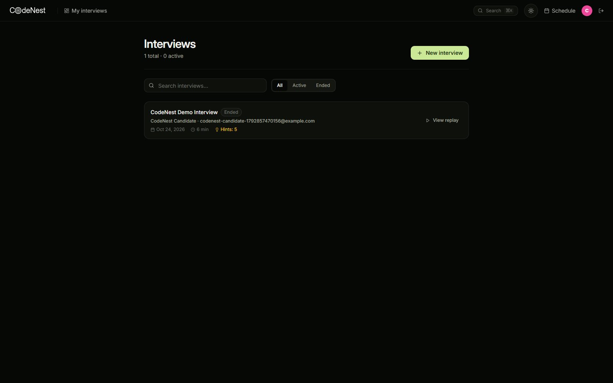
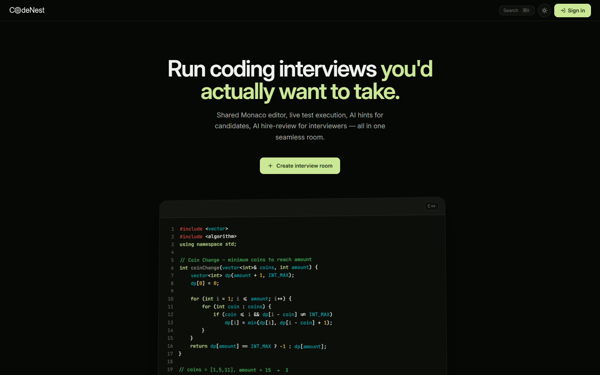
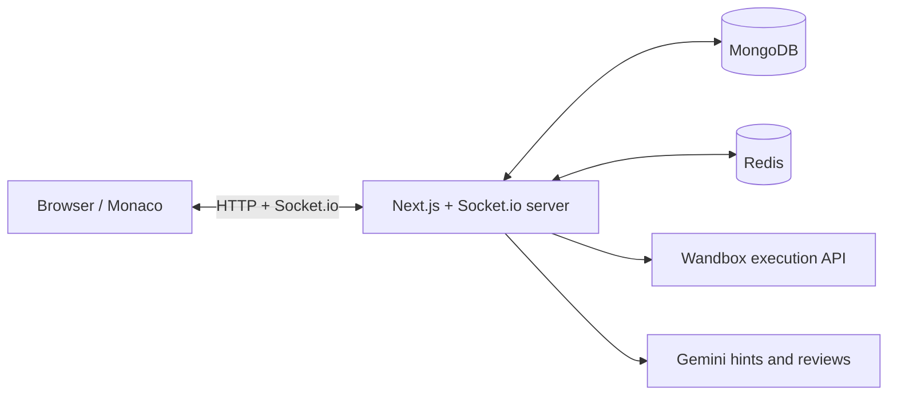

# CodeNest

A 2-person, role-based coding interview platform with real-time editing, AI hints and replayable sessions.

[Live Demo](https://codenest-0xae.onrender.com) · [Quick Start](#quick-start) · [API](#api-reference)

[](https://github.com/ShlokMaharwal/CodeNest/actions/workflows/ci.yml)

<p align="center"></p>

<p align="center">
  
  <br><sub>Candidate editor</sub>
</p>

<p align="center">
  
  <br><sub>AI review</sub>
</p>

<p align="center">
  
  <br><sub>Session replay</sub>
</p>

<p align="center">
  
  <br><sub>Interviewer dashboard</sub>
</p>

<p align="center">
  
  <br><sub>Landing page and room creation</sub>
</p>

## Features

- Two-person rooms with server-enforced interviewer and candidate roles.
- Signed invite links that expire after 24 hours and bind to one candidate identity.
- Real-time code, language, test-case, output, notes and cursor sync through Socket.io.
- Interviewer controls to lock the editor, take control and return control to the candidate.
- Candidate AI hints with configurable room limits and server-counted usage.
- Saved AI reviews covering correctness, code quality, problem solving, communication and a hire recommendation.
- A synchronized countdown timer controlled by the interviewer.
- Wandbox code execution for JavaScript, TypeScript, Python, Java, C++, C, Go and Rust.
- A searchable library of 49 seeded problems; 35 include cases for server-side grading.
- Session replay from periodic, execution and end-of-interview snapshots.

## How it works

1. Register or sign in with an email and password.
2. Create a room, configure its duration and hints, and optionally schedule it.
3. Share the invite link with the candidate, who signs in to join.
4. Select a problem and start the timer; the candidate writes code in the shared editor.
5. Run code with test inputs; the candidate can request hints while the interviewer can lock or control the editor.
6. Generate an AI review with a hire recommendation and end the interview.
7. Open the room replay from the dashboard to step through saved code snapshots and test results.

## Tech stack

Dependency versions below are resolved in `package-lock.json`; service images and the model default come from the repository configuration.

| Layer          | Technology                                                 | Role                                                       |
| -------------- | ---------------------------------------------------------- | ---------------------------------------------------------- |
| Runtime        | Node.js 22.x, npm                                          | Custom HTTP and Socket.io server                           |
| Web            | Next.js 15.5.28, React 18.3.1, TypeScript 5.9.3            | App Router pages and API routes                            |
| Styling        | Tailwind CSS 3.4.19, Framer Motion 12.x                    | Styles and animation                                       |
| Editor         | Monaco 0.55.1, React wrapper 4.7.0                         | Shared code editor                                         |
| Real time      | Socket.io 4.8.3                                            | Room events and code synchronization                       |
| Authentication | NextAuth 4.24.15, bcryptjs                                 | Credentials login and JWT sessions                         |
| Database       | MongoDB 7 Compose image, Mongoose 8.24.7                   | Accounts, problems, rooms and snapshots                    |
| Live state     | Redis 7 Compose image, ioredis 5.10.1                      | Room state, invite bindings, quotas and rate limits        |
| Execution      | Wandbox HTTP API                                           | Eight configured language runtimes                         |
| AI             | Gemini `gemini-2.5-flash`, Google Generative AI SDK 0.24.1 | Hints and structured reviews; model configurable           |
| Verification   | Vitest 5.0.5, ESLint 9, Prettier 3, GitHub Actions         | Tests, coverage, static checks and container health checks |
| Deployment     | Render, Docker Compose                                     | Node web service or app/MongoDB/Redis stack                |

## Architecture



Next.js and Socket.io share the custom Node process in `server.js`. MongoDB stores accounts, problems, room records, reviews and replay snapshots. Redis stores live room state, hint usage, invite bindings and rate-limit windows.

## Quick start

Use Node.js 22.12 or newer within the Node 22 release line, npm and Docker Compose.

```bash
git clone https://github.com/ShlokMaharwal/CodeNest.git
cd CodeNest
npm ci --include=dev
cp .env.example .env
```

On PowerShell, use `Copy-Item .env.example .env`. In `.env`, replace both secret values with different random strings of at least 32 characters. Generate each value separately:

```bash
node -e "console.log(require('crypto').randomBytes(32).toString('hex'))"
```

Keep the local database and app URLs from `.env.example`. Set a real `GEMINI_API_KEY`, or leave it blank to run without AI. Start MongoDB and Redis, seed the problem library, then run the custom development server:

```bash
docker compose up -d mongo redis
npm run seed
npm run dev
```

Open [localhost:3000](http://localhost:3000) and register an account. Seeding upserts 49 problems by title without deleting existing problem IDs; it does not create accounts. An existing `.env.local` takes precedence over `.env`.

For local checks, run `npm run typecheck`, `npm run lint`, `npm test` and `npm run build`. For a production run, build first, then use `npm start`.

## Environment variables

Copy [.env.example](.env.example) to `.env`. Set production values in Render's environment settings. Never commit credentials.

| Name                     | Required       | Description                                                                                                                   |
| ------------------------ | -------------- | ----------------------------------------------------------------------------------------------------------------------------- |
| `MONGODB_URI`            | Yes            | MongoDB connection URI; local default is `mongodb://localhost:27017/codenest`.                                                |
| `REDIS_URL`              | Yes            | Redis TCP URI: `redis://` locally or `rediss://` for TLS services such as Upstash.                                            |
| `NEXTAUTH_SECRET`        | Yes            | Session secret, at least 32 characters.                                                                                       |
| `INVITE_TOKEN_SECRET`    | Yes            | Invite-signing secret, at least 32 characters and different from `NEXTAUTH_SECRET`.                                           |
| `NEXTAUTH_URL`           | Yes            | Public app URL used for authentication, invite links and replay links; local value is `http://localhost:3000`.                |
| `NEXT_PUBLIC_APP_URL`    | For deployment | Browser Socket.io server URL; defaults to `http://localhost:3000` if unset. Set before building for deployment.               |
| `GEMINI_API_KEY`         | For AI         | Gemini API key. Unset or blank disables AI availability; hint/review requests return an unavailable error.                    |
| `GEMINI_MODEL`           | No             | Model ID; defaults to `gemini-2.5-flash`.                                                                                     |
| `SOCKET_ALLOWED_ORIGINS` | No             | Comma-separated exact origins; defaults to the origin of `NEXTAUTH_URL`. Replace the example localhost origin for deployment. |
| `NODE_ENV`               | No             | Defaults to `development`; `npm start` sets `production`.                                                                     |
| `PORT`                   | No             | HTTP and Socket.io listening port; defaults to `3000`.                                                                        |

`NEXT_PRIVATE_DISABLE_TURBOPACK` is set internally by `server.js` and needs no manual configuration.

## API reference

Requests that carry JSON require `Content-Type: application/json`. Protected routes use the NextAuth session cookie. Room IDs are eight lowercase letters/digits; problem IDs are MongoDB ObjectIds.

| Path                         | Methods   | Access                                        | Purpose                                                                                     |
| ---------------------------- | --------- | --------------------------------------------- | ------------------------------------------------------------------------------------------- |
| `/api/auth/[...nextauth]`    | GET, POST | NextAuth protocol                             | Credentials sign-in, session and sign-out endpoints.                                        |
| `/api/auth/register`         | POST      | Public                                        | Register with `name`, `email` and `password` (8–72 bytes; minimum 8 characters).            |
| `/api/rooms`                 | GET       | Signed in                                     | List up to 50 rooms created by the current user, newest first.                              |
| `/api/rooms`                 | POST      | Signed in                                     | Create a room; return `roomId`, `title`, `inviteLink` and `inviteToken`.                    |
| `/api/rooms/[roomId]`        | GET       | Creator or assigned candidate                 | Read room details; `?snapshots=true` includes ordered replay snapshots.                     |
| `/api/rooms/[roomId]`        | PATCH     | Creator; candidate for integrity reports only | Update room settings or submit optional integrity events.                                   |
| `/api/rooms/[roomId]`        | DELETE    | Creator                                       | Delete a non-active room and revoke its current invite.                                     |
| `/api/rooms/[roomId]/invite` | GET       | Creator                                       | Retrieve the invite link; refresh expired tokens; reject ended rooms.                       |
| `/api/problems`              | GET       | Public                                        | Search with `difficulty`, `tag`, `search` and `page`; 20 results per page.                  |
| `/api/problems/[id]`         | GET       | Public                                        | Get problem details and starter code, excluding hidden test cases.                          |
| `/api/problems/[id]/grade`   | POST      | Signed in                                     | Grade `{ code, language }` against stored cases; redact hidden-case inputs and outputs.     |
| `/api/execute`               | POST      | Signed in                                     | Execute `{ code, language, testCases? }`; return `{ result }`.                              |
| `/api/ai/hint`               | POST      | Assigned candidate present in the room        | Accept `{ roomId }`; use stored code/problem and enforce hint limits.                       |
| `/api/ai/review`             | POST      | Creator                                       | Accept `roomId`, problem text, code, language and test results; generate and save a review. |
| `/api/health`                | GET       | Public                                        | Ping MongoDB and Redis; return health flags, process uptime and timestamp.                  |

Execution accepts `javascript`, `typescript`, `python`, `java`, `cpp`, `c`, `go` and `rust`. Each test case has `input` and `expectedOutput`. Limits are 100,000 UTF-8 bytes of source, 16,000 bytes per input/expected output, 20 cases and a shared 20-second execution deadline.

Stored-case grading requires a complete program that reads stdin and prints its result. Comparison trims outer whitespace; hidden results expose only case index, hidden status and pass/fail. Problems without cases return HTTP 400. Execution provider failures appear in `result.errorCode`; grading provider failures return HTTP 503.

Integrity reports use `{ integrityEvents: [{ type: "tab-switch" }] }` on the room PATCH route. Supported types are `tab-switch` and `large-paste` (with optional `size`); the server supplies actor and timestamp. These optional reports are not automatically collected by the current UI.

## Socket events

Socket.io uses `/socket.io` on the same server, with session-cookie authentication and an origin allowlist. After `join-room`, room events require authenticated membership; active-room events reject ended rooms. Every client event below includes `roomId`.

| Client event                      | Role                         | Additional payload                 | Server response / effect                                                                                            |
| --------------------------------- | ---------------------------- | ---------------------------------- | ------------------------------------------------------------------------------------------------------------------- |
| `join-room`                       | Creator or invited candidate | `inviteToken` for candidate        | `room-state`, optional `problem-updated`; peers receive `user-joined`.                                              |
| `code-change`                     | Current editor controller    | `code`                             | Persist code; peers receive `code-update`. A locked candidate cannot edit.                                          |
| `language-change`                 | Either member                | `language`                         | Persist language; broadcast `language-update`.                                                                      |
| `test-cases-change`               | Either member                | `testCases`                        | Persist cases; peers receive `test-cases-update`.                                                                   |
| `output-update`                   | Either member                | `output`                           | Broadcast `output-result` and save an execution snapshot.                                                           |
| `notes-change`                    | Either member                | `notes`                            | Persist notes; peers receive `notes-update`.                                                                        |
| `editor-lock` / `editor-unlock`   | Interviewer                  | None                               | Broadcast `editor-locked` / `editor-unlocked`.                                                                      |
| `take-control` / `return-control` | Interviewer                  | None                               | Broadcast `control-changed` with `controlledBy`.                                                                    |
| `hint-used`                       | Either member                | None                               | Sync that user's server-stored count/text via `hint-count-update` and `hints-text-update`; does not consume a hint. |
| `problem-change`                  | Interviewer                  | `problemId`                        | Load starter code; broadcast `problem-updated` without hidden cases.                                                |
| `timer-start`                     | Interviewer                  | `durationMinutes` (1–240)          | Broadcast `timer-synced` with start time and duration.                                                              |
| `interview-end`                   | Interviewer                  | None                               | Save final snapshot, revoke invite and broadcast `interview-ended` with `replayLink`.                               |
| `integrity-event`                 | Either member                | `event: { type, size? }`           | Save an optional report with authenticated actor and server time.                                                   |
| `cursor-move`                     | Either member                | `position: { lineNumber, column }` | Peers receive `cursor-update`.                                                                                      |

The server also emits `error`, `invite-invalid` and `room-full` for failed access or validation. On disconnect, peers receive `user-left`. Active rooms save automatic snapshots every 60 seconds; replay steps through those snapshots rather than individual keystrokes.

## Project structure

```text
CodeNest/
├── .github/workflows/ci.yml       # Checks, coverage and container verification
├── docs/
│   ├── images/                   # Existing project images
│   ├── screenshots/              # README screenshot paths
│   ├── coverage.svg              # Recorded coverage badge
│   └── RESUME.md                 # Measurements and methodology
├── public/logo.svg
├── scripts/                      # Problem seed data and execution benchmark
├── server/                       # Socket handlers, access rules and shared helpers
├── src/
│   ├── app/
│   │   ├── api/                  # Auth, rooms, problems, execution, AI and health
│   │   ├── dashboard/            # Interviewer room list
│   │   ├── room/[roomId]/        # Live room and replay/page.tsx
│   │   └── ...                   # Landing, login, schedule and access-error pages
│   ├── components/               # Editor, room, shared UI and command palette
│   ├── lib/                      # Service clients, validation, auth and models
│   ├── styles/                   # Monaco editor themes
│   └── types/                    # Shared TypeScript types
├── tests/                        # Unit, API and socket integration tests
├── server.js                     # Custom Next.js + Socket.io entry point
├── docker-compose.yml            # App, MongoDB and Redis services
├── Dockerfile
└── render.yaml                   # Render Node service blueprint
```

## Deployment

The [live CodeNest service](https://codenest-0xae.onrender.com) runs on Render. [render.yaml](render.yaml) defines the Node service configuration:

| Setting           | Value                                   |
| ----------------- | --------------------------------------- |
| Node version      | `22.x` from `package.json`              |
| Build command     | `npm ci --include=dev && npm run build` |
| Start command     | `npm start`                             |
| Health-check path | `/api/health`                           |

Set production database URLs and secrets in Render. Set both app URLs to `https://codenest-0xae.onrender.com` for this deployment, and update or remove the example localhost `SOCKET_ALLOWED_ORIGINS`. Use a TLS `rediss://` connection URL for Upstash. Configure `NEXT_PUBLIC_APP_URL` before building because the browser uses its compiled value. Manually configured Render services need the same commands set in the dashboard.

For UptimeRobot, use an HTTP(s) monitor targeting [https://codenest-0xae.onrender.com/api/health](https://codenest-0xae.onrender.com/api/health). This uncached endpoint returns HTTP 200 when both database pings succeed, or HTTP 503 when either fails; its JSON includes `status`, `mongo`, `redis`, `uptime` (seconds) and `timestamp`.

For the full local container stack, fill `.env`, run `docker compose up --build -d`, then `npm run seed` from the host. Compose supplies internal database URLs to the app, health checks and persistent volumes; database host ports bind to localhost.

## License

[MIT](LICENSE)
